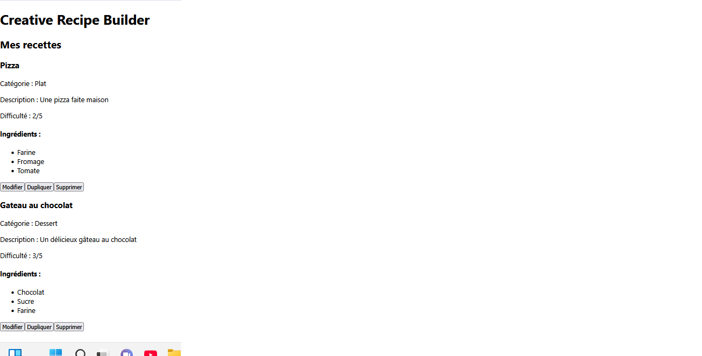
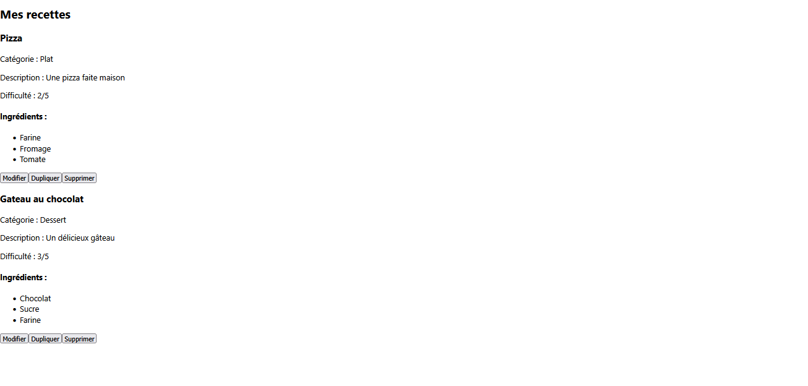
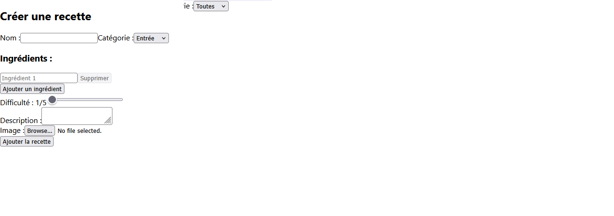

# TP React

## Question 1

Résultat du composant RecipeItem.

## Question 2

Résultat du composant RecipeList.

## Question 3

Résultat du composant RecipeForm.

## Question 4

Résultat du composant RecipeFilter.

